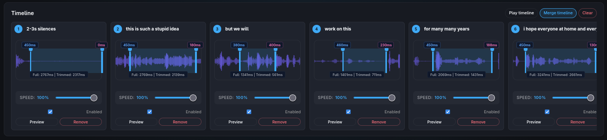
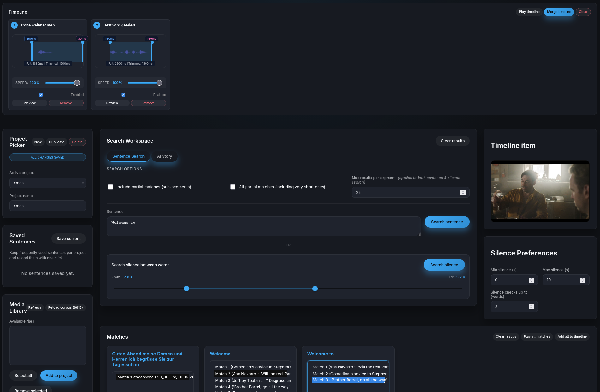
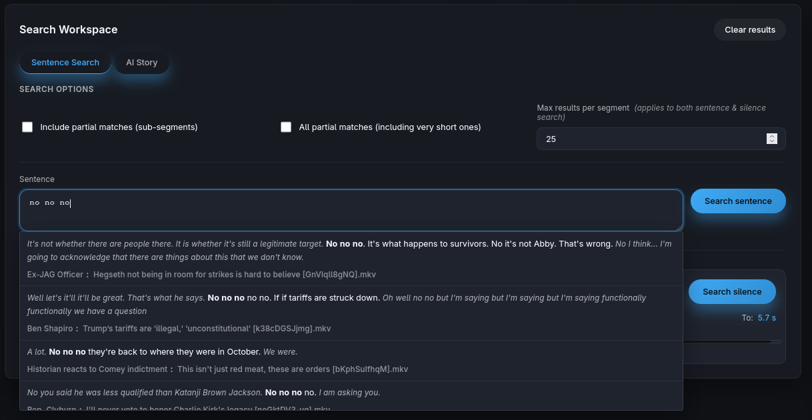
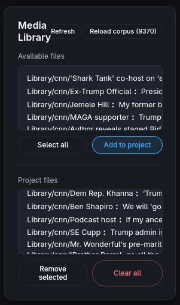
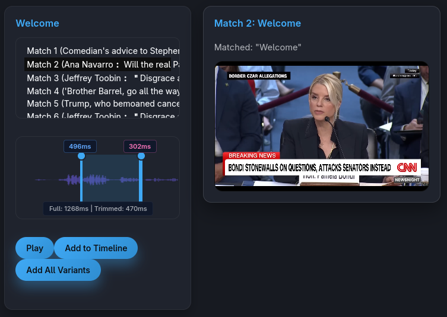
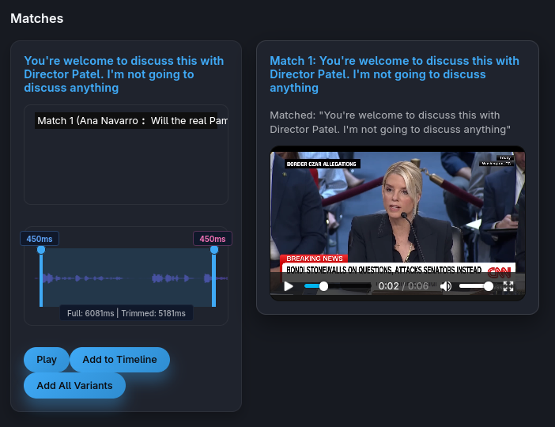

# cinephrase - Video Phrase Extractor

cinephrase is a powerful Flask-based web application for searching, extracting, and compositing video clips based on transcribed speech. Perfect for video editors, content creators, and anyone working with large video collections who needs to find and extract specific spoken phrases.

### Timeline



### Resulting Video
https://github.com/user-attachments/assets/94a54a2e-90e5-4d38-8190-4676f20ced4e

## Overview

cinephrase allows you to:
- Search through transcribed videos by sentence, phrase, or word
- Find moments with specific silence/pause durations between words
- Generate AI-powered video stories from your clip library (very large context required for corpus content puzzling)
- Build video timelines by arranging matched segments
- Adjust playback speed per segment
- Export merged video compilations with GPU acceleration
- Manage multiple projects with saved search preferences
- Realtime saving of all actions

## Features

### 🔍 Advanced Search Capabilities

- **Sentence Search**: Find exact or partial matches of spoken phrases across your video library
- **Silence Search**: Locate clips with specific pause durations (0-10s) between words
- **Partial Match Support**: Find sub-segments within longer phrases
- **Multi-file Search**: Search across multiple video files simultaneously
- **Real-time Streaming Results**: See matches as they're found during search

### 🎬 Video Editing & Timeline

- **Interactive Timeline**: Drag and drop clips to arrange your video sequence
- **Sample-accurate Preview**: Clips and the whole timeline play on the Web Audio clock, so a cut sounds exactly
  where the merged video will have it (see [How timing works](#how-timing-works))
- **Instant Trimming**: Drag the handles on the waveform, or use the arrow keys (10 ms, Shift: 1 ms,
  PageUp/PageDown: 100 ms); the new trim plays immediately, nothing is re-rendered
- **Video Merging**: Export your timeline as a single merged video file
  - Every cut lands within a fraction of a millisecond of the timeline, without accumulating drift
  - GPU-accelerated encoding (NVENC/QSV/AMF/VideoToolbox) when available
  - Automatic fallback to CPU encoding
  - Concurrent stream limiting for GPU stability (use nvidia-patch for more parallel encoding streams)
- **Clip Manipulation**: Delete, disable, slow down and reorder timeline segments

### 🤖 AI Story Generation

- **LLM Integration**: Generate creative video stories from your clip corpus
- **Custom Prompts**: Describe the type of story you want (drama, news, comedy, etc.)
- **Smart Segment Selection**: Prefers longer, more substantial clips
- **Debug Mode**: Inspect the LLM prompt, corpus, and raw responses
- **Manual Response Processing**: Copy prompts to external LLMs and paste responses back

### 📁 Project Management

- **Project System**: Save and load different search sessions
- **Saved Sentences**: Store frequently used search phrases per project
- **Source File Selection**: Choose which video files to search within each project
- **Autosave**: Automatic project state persistence
- **Project Duplication**: Clone projects as starting templates

### 📝 Transcription Support

Use videogrep transcribe feature or https://github.com/cmprmsd/video-transcriber-with-whisper-timestamped for GPU accelerated high quality transcribtions

A video is searchable as soon as one of these files sits next to it (same name, different extension):

- `video.json`: word-level transcript (videogrep / Vosk / Whisper format) - exact word timings
- `video.vtt` with inline word timestamps (YouTube captions) - converted to `video.json` on first use
- `video.srt` / plain `video.vtt`: word times are estimated inside each subtitle cue. Good enough to find a
  phrase; fine-trim it on the waveform. `srt_word_boundaries.py` can align such subtitles to an ASR transcript
  for exact timings.

### 🎯 Silence Filtering

Fine-tune results based on pauses:
- Set minimum/maximum silence duration around matches
- Configure silence checks for short phrases (e.g., 1-2 words)
- Longer segments can bypass silence restrictions

### 📊 Advanced Features

- **Waveform Visualization**: View audio waveforms for clips
- **Corpus Search**: Full-text search across all transcriptions
- **Sentence Autocomplete**: Tab-completion for phrase suggestions from the speech corpus
- **Search Cancellation**: Stop long-running searches mid-process
- **Segment Skipping**: Hide unwanted matches during active searches (partial skip during search)


## Screenshots

### Full UI


### Realtime suggestions


### Media Library


### Many results


### Long sentence search



## Installation

### Prerequisites

- Python 3.9 or higher
- FFmpeg with ffprobe (required for video processing; developed against FFmpeg 6, the filters used need 4.2 or newer)
- A current browser (Chrome, Edge, Firefox or Safari)
- A GPU with an H.264 hardware encoder (optional, for faster encoding)

### Step 1: Clone the Repository

```bash
git clone <repository-url>
cd cinephrase
```

### Step 2: Install Python Dependencies

```bash
pip install -r requirements.txt
```

`requirements-transcribe.txt` holds the (large) packages for creating transcripts with Vosk/Whisper. The server
itself does not need them.

## Usage

### 1. Transcribe Your Videos

Before searching, you need to transcribe your video files to generate word-level timing data.
Use my [video transcriber script](https://github.com/cmprmsd/video-transcriber-with-whisper-timestamped).

### 2. Start the Web Server

```bash
python server.py
```

**Optional arguments:**
```bash
# Address and port (default 127.0.0.1:5000). Use 0.0.0.0 to reach it from other devices.
python server.py --listen 0.0.0.0:8080

# The app answers only when opened by IP address, as localhost or under this machine's name (the server has
# no login; this keeps other web sites from reaching it through your browser). Other names, e.g. behind a
# reverse proxy, must be allowed:
python server.py --listen 0.0.0.0:8080 --allowed-host media.example.org

# Additional video folders (repeatable); the Library/ folder next to server.py is always used
python server.py --library-path /path/to/videos --library-path /another/folder

# GPU encoding configuration
python server.py --gpustreams 2  # Max concurrent GPU encoding streams

# Format of merged videos (default: the most common resolution / frame rate of the timeline)
python server.py --merge-resolution 1920x1080 --merge-fps 30

# LLM for "AI Story" (an Ollama server); also read from OLLAMA_URL / OLLAMA_MODEL
python server.py --ollama-url http://localhost:11434/api/generate --ollama-model llama3.2:latest

# Flask debug mode (auto-reload, interactive debugger). Never on a public address.
python server.py --debug
```

The server will:
- Scan the `Library/` directory (and every `--library-path`) for videos (`.mp4`, `.mkv`, `.webm`, `.mov`,
  `.m4v`, `.avi`) and their transcripts
- Start a web server (default: `http://localhost:5000`)
- Auto-detect available GPU encoders

> The server has no login. Only expose it (`--listen 0.0.0.0`) on a network you trust.

### 3. Using the Web Interface

#### Initial Setup

1. Open `http://localhost:5000` in your web browser
2. Select files from "Available files" and click **"Add to project"**
3. Click **"Load corpus"** to enable full-text autocomplete search

#### Creating a Project

1. Click **"New"** in the Project Picker section
2. Enter a project name
3. Add source files to your project
4. The project auto-saves as you work

#### Searching for Clips

**Sentence Search:**
1. Enter a phrase in the "Sentence" field (e.g., "hello world"); separate several phrases with `;`
2. With the corpus loaded, suggestions appear while typing: Tab adds the next word, the arrow keys and Enter
   (or a click) take a whole suggestion. When the words you typed are not spoken one after the other anywhere,
   a `;` is inserted before the last word to start a new phrase; Backspace right away undoes it
3. Click **"Search sentence"**
4. Results appear in the Matches section below; phrases without a match are listed there

**Silence Search:**
1. Adjust the dual-range slider to set min/max silence duration
2. Click **"Search silence"**
3. Find clips with specific pause lengths between words

**Search Options:**
- **Include partial matches**: Find sub-segments within longer phrases
- **All partial matches**: Include very short segments
- **Max results per segment**: Limit matches (default: 25); the results are spread over the selected videos

**Wildcards** (looked up in the loaded corpus):
- `ball*` - words starting with "ball" (`*ball`, `b*ll` work too; a `*` on its own is one whole word: `der * ist`)
- `ball**` - from a word starting with "ball" to the end of its sentence
- `**ball` - from the start of a sentence up to a word ending in "ball"
- `**ball**` - whole sentences containing "ball"
- A term is expanded to at most 50 phrases; a notice says when there were more

**Auditioning matches:**
- Click a match (or use the arrow keys in the list) to play it; Space replays, Enter adds it to the timeline
- Drag the waveform handles or use the arrow keys on a focused handle to trim; the trim is remembered per match
- Click the preview picture to stop or replay; its top right corner has mute, volume and fullscreen

#### Building a Timeline

1. Click **"Add to timeline"** on any match card (or drag the card title onto the timeline)
2. Clips appear in the Timeline section at the top
3. Drag clips to reorder them (a bar shows where the clip will land); Ctrl+Z undoes, Ctrl+Shift+Z redoes.
   Keyboard: Tab to a clip, then Enter plays it, Alt+arrow keys move it, Delete removes it
4. Use **"Play timeline"** to preview the sequence: it plays gaplessly, exactly as the merge will cut it
5. Click **"Merge timeline"** to export as a single video file
6. Download button is below the preview on the right

Preview clips live in `temp/`. If that folder was cleaned, clips are re-created from the source videos when
they are played; **"Restore missing clips"** does it for the whole timeline.

#### Using AI Story Generation

1. Switch to the **"AI Story"** tab
2. Enter a story prompt (e.g., "Create a dramatic news story about climate change")
3. Click **"Generate Story"**
4. Review the generated segment list
5. Matches automatically populate (hopefully) based on the AI's selections

**Advanced AI Workflow:**
1. Click **"Copy LLM Prompt"** to get the prompt with corpus
2. Paste into your preferred LLM (Claude, GPT-4, etc.)
3. Copy the JSON response
4. Click **"Insert Response"** and paste the LLM's output
5. Click **"Process Response"** to search for the suggested clips

#### Silence Preferences

Configure pause filtering in the right sidebar:
- **Min silence**: Minimum pause duration to allow (seconds)
- **Max silence**: Maximum pause duration to allow (seconds)
- **Silence checks up to**: Only apply checks to short clips (word count)

Example: Set min=0.2, max=1.5, threshold=2 to require 0.2-1.5s pauses around 1-2 word clips, but allow any pauses for longer phrases.

### 4. Managing Projects

**Save Current Sentence:**
- Saves your current search phrase to the project
- Reusable with one click from "Saved Sentences" list

**Duplicate Project:**
- Creates a copy of the current project
- Useful for creating variants or templates

**Delete Project:**
- Removes the project permanently - yes no going back

## File Structure

```
cinephrase/
├── server.py                    # Flask application: search, clip export, projects, API
├── render_pipeline.py           # Sample-accurate cutting shared by preview audio and merge
├── srt_word_boundaries.py       # Subtitle -> word timing conversion / alignment
├── requirements.txt             # Python dependencies of the server
├── requirements-transcribe.txt  # Optional: packages for creating transcripts
├── static/
│   ├── frontend.js              # Web interface logic
│   ├── clip-player.js           # Preview engine (Web Audio clock)
│   ├── style.css                # UI styling
│   └── favicon.ico
├── templates/
│   └── index.html               # Main web interface
├── tests/                       # python -m unittest discover -s tests
├── Library/                     # Default video source directory
│   └── (your videos and transcripts)
├── data/                        # Project storage (projects.json, collections.json, .bak copies)
└── temp/                        # Preview clips and merged videos
```

## How timing works

A cut is only exact if preview and export agree on what a millisecond means, so both use the same definition:
a clip is *a library video plus start/end bounds*, and a trim is a number of milliseconds taken off either end.

- **Preview**: the browser fetches the clip's audio as PCM (`/clip_audio`, cut by ffmpeg with sample accuracy)
  and plays it with the Web Audio API. Playback starts and stops on exact audio samples, and "Play timeline"
  schedules all clips back to back on the same clock. The picture is a muted `<video>` that follows the audio
  clock; it is accurate to about one frame, which is all a video frame can be.
- **Merge**: `render_pipeline.py` gives every clip an exact number of audio samples and video frames. Audio is
  contiguous (no padding between clips), each picture cut lands on the nearest output frame, and rounding never
  accumulates. Every clip is cut once from its source video; the pieces are joined without re-encoding the
  picture.
- **Waveform**: drawn from the same PCM, so the trim handles sit on the audio they cut.

Measured with the test suite: cuts land within 0.3 ms of the timeline, independent of the number of clips.
Clips with a speed below 100 % are time-stretched by ffmpeg (`atempo`); their boundaries are exact, the
stretched audio inside is what ffmpeg produces.

## GPU Acceleration

The application automatically detects and uses available GPU encoders:

**Supported GPU Encoders** (H.264, so browsers can play the preview clips):
- **NVENC** (NVIDIA): h264_nvenc
- **QuickSync** (Intel): h264_qsv
- **AMF** (AMD): h264_amf
- **VideoToolbox** (macOS): h264_videotoolbox

Each encoder ffmpeg lists is test-encoded at startup; the first one that works is used.

**Configuration:**
- `--gpustreams N` - Limit concurrent GPU encoding jobs (default: 2)
- Automatic fallback to CPU (libx264) if GPU fails
- Runtime GPU failure detection and automatic CPU fallback

## Tips & Best Practices

### Transcription Quality

- **Use larger Vosk models** for better accuracy
- **Use [Whisper-Timestamped](https://github.com/cmprmsd/video-transcriber-with-whisper-timestamped)** for highest quality
- **Align high-quality SRT subtitles** with Vosk timings for best of both worlds
- Check audio track language metadata matches your model

### Search Strategies

- **Use semicolon for separation** in searches: "hello; world" creates two separate segments
- **Enable partial matches** to find phrases within longer sentences e.g. "hello from earth" would result in "hello" clips as well as "from earth"
- **Adjust silence preferences** to filter out clips where the pause to the next word is too narrow
- **Save frequently used phrases** to project sentences for quick reuse

## Troubleshooting

### No search results?

- Verify `.json` transcription files exist next to video files
- Check that files are added to your project in the Media Library
- Try enabling "Include partial matches" option
- Verify transcription language matches search text

### GPU encoding fails?

- Check NVIDIA/AMD/Intel drivers are up to date
- Try reducing `--gpustreams` to 1
- Application automatically falls back to CPU encoding
- Check FFmpeg GPU encoder support: `ffmpeg -encoders | grep nvenc`

### No sound in the preview?

- The browser only starts audio after a click or key press in the page: click the preview once
- Check the browser console (F12) for a failed `/clip_audio` request; the message says what is missing

### Transcription fails?

- Verify FFmpeg is installed: `ffmpeg -version`
- Check video file audio track is not corrupted
- Ensure sufficient disk space for temporary audio files

### Web interface issues?

- Clear browser cache and reload
- Check browser console (F12) for JavaScript errors
- Verify server is running: `curl http://localhost:5000`
- Check server terminal for Python errors

## Advanced Configuration

### Custom Source Directory

```bash
python server.py --library-path /path/to/your/videos
```

### Corpus

"Load corpus" fetches the sentences of the project's videos for autocomplete and wildcards. The same data is
available from the API:

```bash
curl -X POST -H 'Content-Type: application/json' \
     -d '{"files": ["Library/video.mp4"]}' http://localhost:5000/get_sentences
```

### AI Story

"AI Story" sends the corpus of the selected videos to an [Ollama](https://ollama.com/) server. Point the app at
yours with `--ollama-url` / `--ollama-model` (or `OLLAMA_URL` / `OLLAMA_MODEL`). Without one, use
**"Copy LLM Prompt"**, paste it into any LLM and feed the answer back with **"Insert Response"**.

## Development Notes

### Main Components

- **server.py**: Flask routes, search and matching, preview clip export, GPU encoding, project storage
- **render_pipeline.py**: timeline planning (exact sample/frame budgets), PCM extraction, merge rendering
- **static/clip-player.js**: preview engine - audio on the Web Audio clock, pictures following it
- **static/frontend.js**: Web UI - search, result cards, waveform trimming, timeline, autosave
- **srt_word_boundaries.py**: Subtitle parsing and alignment against ASR word timings

### Tests

```bash
python -m unittest discover -s tests -v
```

The tests generate small synthetic videos with ffmpeg and check, among other things, where every cut of a merge
lands (by cross-correlating the output with the source).

### API Endpoints

- `GET /` - Main web interface
- `GET /get_files` - List available video files
- `POST /get_sentences` - Sentences of the given videos (corpus)
- `POST /search_longest_segments_stream` - Stream sentence search results
- `POST /search_silences_stream` - Stream silence search results
- `POST /skip_segment`, `POST /cancel_search` - Control a running search
- `GET /clip_audio` - PCM (WAV) of a clip for the sample-accurate preview
- `POST /get_waveform` - Waveform and exact duration of a clip
- `POST /ensure_clip` - Re-create a preview clip that is missing from `temp/`
- `POST /merge_videos_stream` - Render the timeline, streaming progress
- `POST /generate_story`, `POST /generate_story_prompt` - AI story generation
- `POST /parse_story_response` - Read an LLM answer that was pasted in
- `GET /api/projects` - List all projects
- `POST /api/projects` - Create new project
- `GET|PUT|DELETE /api/projects/<id>` - Read, update, delete a project
- `GET|POST /api/collections`, `DELETE /api/collections/<id>` - File collections

## Contributing

Contributions are welcome! Areas for improvement:

- UX improvements for drag and drop in the timeline
- Better partial sentence search
- Improving the sentence auto completion to autotab over to the next sentence without splitting (auto semicolon insertion)
- Batch export capabilities
- Video effect support (transitions, filters)

## License

GPL 3

## Credits

Built with:
- [Flask](https://flask.palletsprojects.com/) - Web framework
- [videogrep](https://github.com/antiboredom/videogrep) - Video processing
- [Vosk](https://alphacephei.com/vosk/) - Speech recognition
- [OpenAI Whisper](https://github.com/openai/whisper) - Speech recognition
- [FFmpeg](https://ffmpeg.org/) - Multimedia framework
